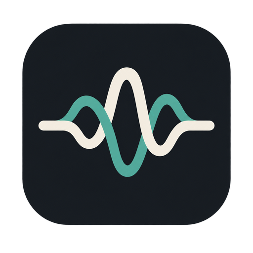
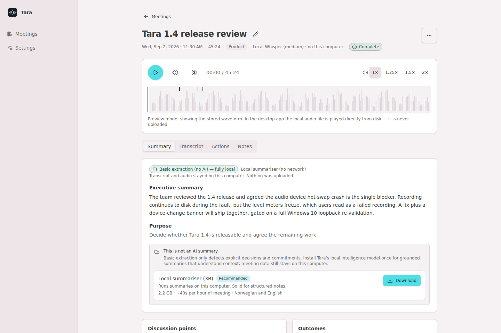
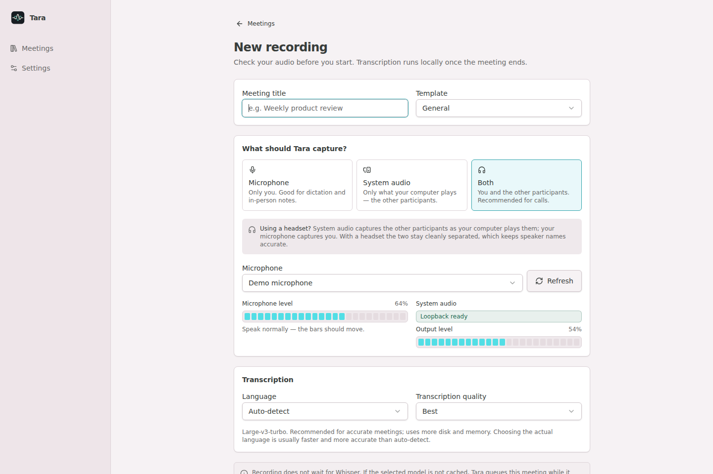
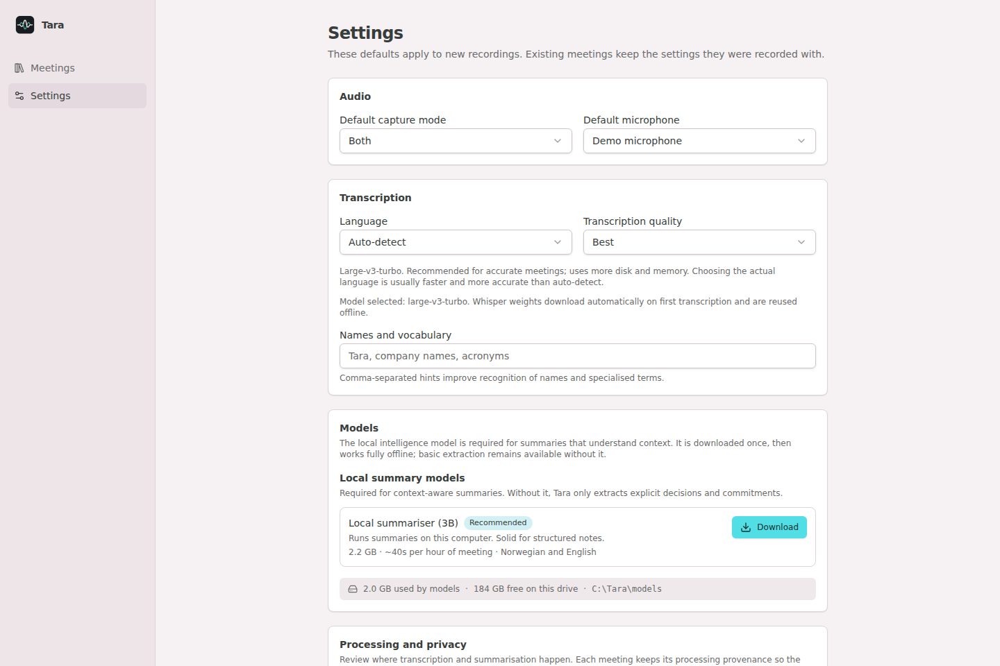

<div align="center">
  
  <h1>Tara</h1>
  <p><strong>Local-first meeting transcription and intelligence for Windows.</strong></p>
  <p>Record both sides of a call, transcribe locally, and turn meetings into grounded notes—without requiring a cloud account.</p>

  [](https://github.com/Pilvik1/tara-local-meeting-assistant/actions/workflows/ci.yml)
  [](https://github.com/Pilvik1/tara-local-meeting-assistant/actions/workflows/security.yml)
  [](https://github.com/Pilvik1/tara-local-meeting-assistant/actions/workflows/desktop-release.yml)
  [](LICENSE)
</div>

> **Status:** Windows beta. The repository is prepared for public contribution,
> but official executables are currently unsigned and may trigger SmartScreen.

## What Tara does

- **Captures both sides of online meetings.** Microphone and Windows loopback
  audio are stored as separate synchronized recordings.
- **Transcribes locally.** Choose Fast (`small`) or Best (`large-v3-turbo`), with
  Norwegian, English, mixed-language, or automatic language handling.
- **Builds grounded meeting intelligence.** An optional local Qwen3 model through
  llama.cpp produces summaries, decisions, actions, risks, topics, and meeting Q&A.
- **Rejects unsupported claims.** Structured outputs must cite transcript evidence;
  Tara abstains when a decision, owner, deadline, or risk is not supported.
- **Keeps a useful local archive.** Search meetings, play each source, edit notes,
  retranscribe, and export Markdown, DOCX, or PDF.

## Screenshots

<p align="center">
  
</p>

<details>
<summary>Recording preflight and privacy settings</summary>





</details>

Screenshots use synthetic demo data and do not contain real meetings.

## Download

Download the newest installer or portable executable from
[GitHub Releases](https://github.com/Pilvik1/tara-local-meeting-assistant/releases).

Each release includes:

- `Tara.Setup.<version>.exe` — Windows installer;
- `Tara.<version>.exe` — portable executable;
- a ZIP containing both executables;
- `SHA256SUMS.txt` for integrity verification;
- an SPDX JSON software bill of materials.

The packaged app bundles Electron, the frozen Python backend, and llama.cpp.
Python and Node.js are not required on the target computer. Whisper weights are
downloaded on first use; the optional Qwen model is a separate explicit download.

## Privacy model

The default desktop path is local:

```text
Microphone + Windows system audio
              │
              ▼
 Separate local audio recordings
              │
              ▼
   Local faster-whisper transcription
              │
              ▼
 Local Qwen analysis through llama.cpp
              │
              ▼
      Local SQLite meeting library
```

Tara contains no telemetry, analytics, advertising, required cloud account, or
silent hosted-AI fallback. Network activity is limited to explicit model/release
downloads and optional operator-configured SMTP delivery. See [PRIVACY.md](PRIVACY.md)
for storage, deletion, network, and recording-consent boundaries.

Packaged launches additionally use a fresh desktop API token and backend
instance identity, preventing unrelated local web content from driving Tara's
loopback API.

## Using Tara with a headset

For Google Meet, Microsoft Teams, Zoom, or similar calls:

1. Choose **Both** on the recording preflight screen.
2. Select the intended microphone.
3. Confirm that both the microphone and system-audio meters move.
4. Obtain the required recording consent.
5. Start recording; Tara preserves the two sources separately.
6. After the call, review source playback before relying on the transcript.

Windows loopback captures all system audio during the session, not only one app.

## Development

### Requirements

- Node.js 24 or newer;
- Python 3.11;
- npm;
- Windows 10/11 for Windows loopback capture and release packaging.

### Install

```bash
npm ci
python3 -m venv .venv
.venv/bin/python -m pip install -r backend/requirements.txt
```

Windows PowerShell:

```powershell
npm ci
python -m venv .venv
.\.venv\Scripts\python -m pip install -r backend\requirements.txt
```

### Run

```bash
npm run dev       # local API + browser renderer
npm run electron  # local API + Electron shell
```

Local services:

- API: `http://127.0.0.1:8765`
- Vite: `http://127.0.0.1:5173`

### Validate

```bash
npm run lint
npm run test:frontend
npm run test:backend
npm run build
npm audit --omit=dev
npm audit --audit-level=high
```

The Windows workflow additionally freezes and starts the Python backend, verifies
the pinned llama.cpp runtime, proves meeting persistence across backend restart,
packages installer and portable targets, and stages checksums plus an SBOM.

## Architecture

| Layer | Responsibility |
| --- | --- |
| Electron | Desktop lifecycle, Windows loopback permission, local file writes, narrow preload bridge |
| React + TypeScript | Audio preflight, recording, meeting library, review, settings, model management |
| FastAPI + SQLite | Persistence, transcription orchestration, grounded analysis, search, Q&A, export |
| faster-whisper | Local speech-to-text using downloaded Whisper-compatible weights |
| llama.cpp + Qwen3 | Optional local structured meeting intelligence |

See [architecture.md](architecture.md) for trust boundaries and component detail.

## Known limitations

- transcription starts after recording; live transcription is not implemented;
- remote participants are not individually diarized;
- Tara does not encrypt recordings or SQLite data itself;
- initial model downloads require an internet connection and several gigabytes;
- optional SMTP delivery is not local-only;
- official beta executables are unsigned;
- Windows is the only release target with proven system-audio capture.

## Contributing and security

Read [CONTRIBUTING.md](CONTRIBUTING.md) before opening a pull request. Commits
require a Developer Certificate of Origin sign-off. Suspected vulnerabilities
must follow the private process in [SECURITY.md](SECURITY.md), not a public issue.

## License and identity

The source code and original repository artwork are licensed under
[AGPL-3.0-only](LICENSE). Third-party software and model weights retain their own
licenses; see [THIRD_PARTY_NOTICES.md](THIRD_PARTY_NOTICES.md).

The Tara name and logo identify the maintainer's official builds and are not a
promise of trademark clearance. Fork distributors should use a distinct product
identity. See [BRANDING.md](BRANDING.md).
